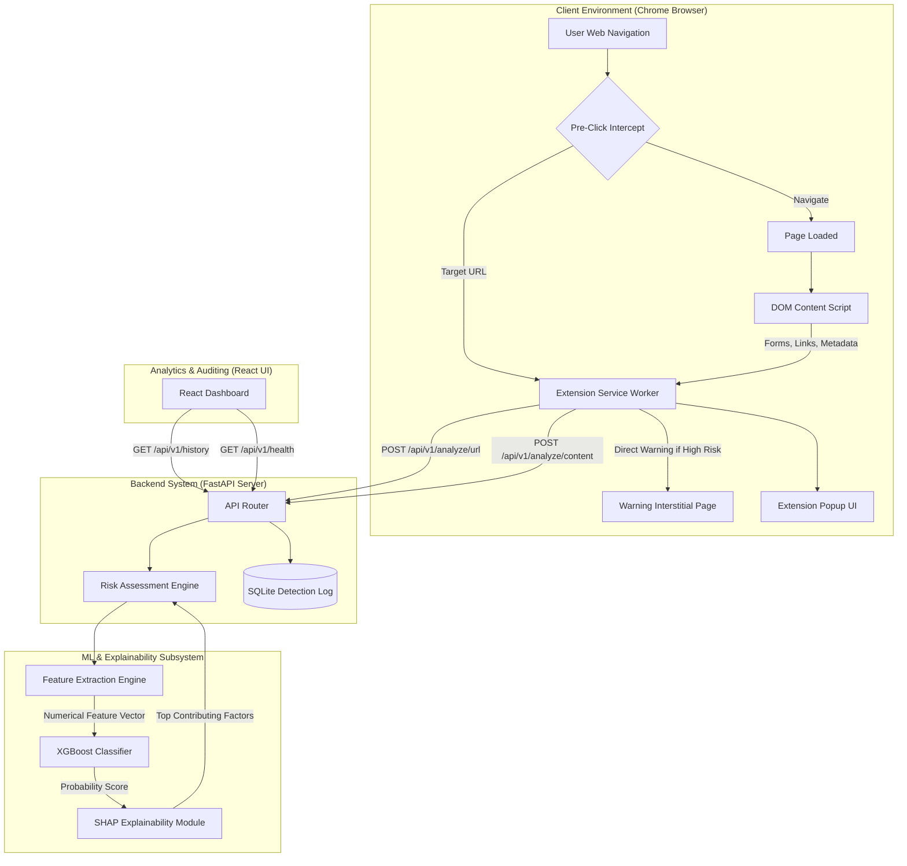

# System Architecture — AI-Powered Phishing Protection

This document outlines the architectural blueprint, data flow, component boundaries, and security considerations for the Phishing Protection System.

---

## 1. High-Level Architecture Diagram

---

## 2. Multi-Tier Analysis Strategy

Phishing defense operates on a defense-in-depth model with two distinct stages:

### Tier 1: Pre-Click URL Analysis (Fast Path)
- **Goal**: Prevent navigation to known or structurally anomalous malicious URLs before the browser fetches any remote assets.
- **Latency Target**: `< 150ms`.
- **Triggers**: User hovering over links, clicking hyperlinks, or typing a destination in the address bar.
- **Features Analyzed**:
  - URL length, path depth, token counts.
  - Presence of IP address in hostname.
  - Suspicious TLDs (`.xyz`, `.top`, `.tk`, etc.).
  - Hyphen count, `@` symbol, digit counts.
  - Subdomain entropy and punycode/homograph detection.
- **Outcome**: If classified as High Risk, navigation is immediately suspended, and the user is redirected to the `warning/warning.html` interstitial page.

### Tier 2: Post-Click Webpage Content Analysis (Deep Path)
- **Goal**: Detect cloaked phishing sites whose URLs appear innocuous but whose rendered page mimics legitimate organizations to harvest credentials.
- **Latency Target**: Evaluated asynchronously after initial DOM parse.
- **Triggers**: Page `DOMContentLoaded` and dynamic DOM mutations.
- **Features Analyzed**:
  - Presence of password input fields on non-HTTPS origins or mismatched domains.
  - External form action targets (e.g., submitting credentials to an unverified third-party host).
  - High ratio of external resource links vs. internal links.
  - Suspicious zero-pixel iframes or hidden elements.
  - Favicon and page title mismatch indicators (brand impersonation).
- **Outcome**: Injects an in-page warning banner or upgrades the URL risk level.

---

## 3. Dynamic Risk Assessment Engine

The risk engine computes a normalized composite score $S \in [0.0, 1.0]$ by synthesizing ML classification probabilities and deterministic heuristic rules:

$$\text{Composite Risk} = w_1 \cdot P_{\text{ML}}(\text{Phishing}) + w_2 \cdot H_{\text{Content}} + w_3 \cdot H_{\text{Domain}}$$

### Risk Categories:
1. **Low Risk ($0.00 \le S < 0.30$)**:
   - Legitimate domain characteristics, verified reputation, no suspicious DOM elements.
   - Action: Allow navigation quietly, icon in browser remains green.
2. **Medium Risk ($0.30 \le S < 0.70$)**:
   - Ambiguous lexical patterns, newly registered domain indicators, or minor anomalies.
   - Action: Allow navigation with visual caution badge in extension popup and non-intrusive notification.
3. **High Risk ($0.70 \le S \le 1.00$)**:
   - Definite credential harvesting form, high ML phishing probability, or known phishing signatures.
   - Action: Intercept navigation, display the full-page interstitial warning, record event to detection database.

---

## 4. Machine Learning & Explainable AI (XAI)

- **Model Choice**: **XGBoost (Extreme Gradient Boosting)**
  - Why: High tabular data accuracy, robust handling of non-linear feature interactions, fast inference speed compared to heavy neural networks.
- **Explainability**: **SHAP (SHapley Additive exPlanations)**
  - Why: Generates local explanations per URL analysis. Instead of giving a black-box percentage, the system produces actionable explanations:
    - *“Risk increased by 35% due to an IP address used as the hostname.”*
    - *“Risk increased by 22% due to excessive subdomains mimicking paypal.com.”*

---

## 5. Security & Privacy Guarantees

1. **Local & Autonomous**: The system does not route user browsing traffic to external commercial AI APIs (such as OpenAI or third-party web scrapers).
2. **Minimal Data Retention**: The backend logs anonymized URL structures, risk scores, and timestamps. Sensitive query parameters (e.g., tokens, session IDs) are stripped before storage.
3. **No Weaponized Payloads**: All fixtures, tests, and mock scenarios use safe domains (`example.com`, RFC 2606 reserved domains).
